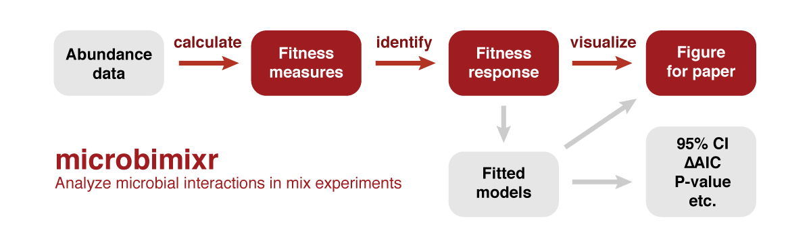
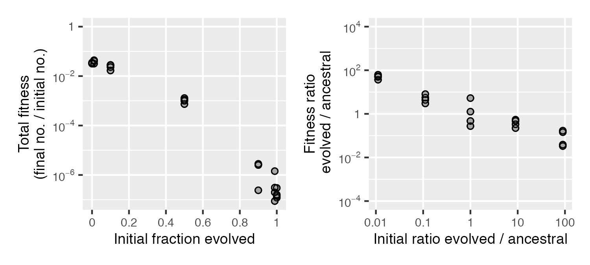
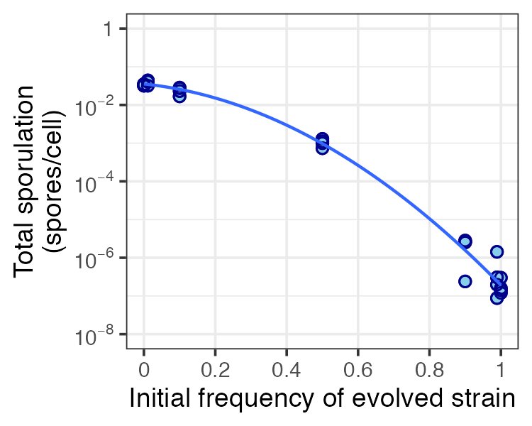

<!-- README.md is generated from README.Rmd. Please edit that file -->

```{r, include = FALSE}
knitr::opts_chunk$set(
  collapse = TRUE,
  comment = "#>",
  fig.path = "man/figures/README-",
  out.width = "100%"
)
```

<!-- badges: start -->
[](https://github.com/matryoshkev/microbimixr/actions/workflows/R-CMD-check.yaml)
[](https://app.codecov.io/gh/matryoshkev/microbimixr)
<!-- badges: end -->

## Analyze microbial interactions in mix experiments

Studies of cooperation and conflict among microbes often use a common experimental design: mix together two microbes (different strains of bacteria, for example) then measure how their survival and reproduction depend on strain frequency. How do they act differently together than they do on their own? microbimixr helps you get the most out of this data by providing tools to:

* Calculate best-practice fitness measures
* Identify which fitness measures are best for your data and research question
* Visualize interaction effects as publication-quality figures




## Calculate fitness measures

There are many ways to quantify microbial survival and reproduction. microbimixr makes it easy to calculate fitness measures that are: 

* Robust and quantitatively comparable across different species and different types of interaction
* Well-suited to statistical analysis of effect sizes and confidence intervals
* Useful for both individual and group-centered approaches to social behavior
* Directly comparable to theoretical models of microbial evolution

Starting from a data frame with the initial and final abundance of each microbe, calculate fitness with `calculate_mix_fitness()`:

```{r eval = TRUE}
library("microbimixr")
fitness_myxo <- calculate_mix_fitness(
	data_smith_2010, 
	var_names = c(
		initial_number_A = "initial_cells_evolved",
		initial_number_B = "initial_cells_ancestral",
		final_number_A = "final_spores_evolved",
		final_number_B = "final_spores_ancestral", 
		name_A = "evolved", 
		name_B = "ancestral"
	)
)
head(fitness_myxo)
```

microbimixr works with most types of microbial abundance data including cell counts, cell density, optical density, and strain frequency. 


## Identify fitness response

To quickly see what fitness measures would be most useful for your research question and data, use `plot_mix_fitness()`. It draws a combined figure that lets you compare strain fitness, total fitness, and the ratio of strain fitnesses. It also lets you compare linear and logarithmic measures of strain frequency. 
```{r eval = FALSE}
plot_mix_fitness(fitness_myxo)
```
<!-- ggplot2::ggsave("README-compare-measures.png", width = 6.25, height = 4.5) -->


For example, this interaction between two genotypes of _Myxococcus_ bacteria would be easiest to interpret and analyze as total fitness as a function of initial genotype fraction and fitness ratio as a function of initial genotype ratio. They're the simplest fitness responses and easiest to fit statistical models to. These plots also let you interpret your data in terms of the different fitness outcomes used by theories of social evolution like kin selection, multilevel selection, and game theory. 


## Visualize fitness effects

Once you know which fitness measures to analyze, you can use microbimixr to make publication-quality figures. The package includes convenience functions to plot data with default settings appropriate for mix experiments. Fitness axes are plotted on $\log_{10}$ scales, for example, include 1 for reference (no net change in abundance), and have a minimum ten-fold range. 

```{r eval = FALSE}
library("patchwork")
fig_total <- plot_total_fitness(fitness_myxo)
fig_ratio <- plot_fitness_ratio(fitness_myxo, mix_scale = "ratio", ylim = c(1e-4, 1e4))
fig_total + fig_ratio
```
<!-- ggsave("README-plots-simple.png", width = 5, height = 2.25) -->


You can also customize these plots using the [ggplot2](https://ggplot2.tidyverse.org/) graphics package:
```{r eval = FALSE}
library("ggplot2")
fitness_myxo |>
	plot_total_fitness(
		xlab = "Initial frequency of evolved strain",
		ylab = "Total sporulation\n(spores/cell)", 
		ylim = c(1e-8, 1), color = "darkblue", fill = "skyblue"
	) +
	geom_smooth(
		method = "lm", formula = y ~ poly(x, 2), 
		se = FALSE, linewidth = 0.5
	) +
	theme_bw(base_size = 9)
```
<!-- ggsave("README-plots-custom.png", width = 2.5, height = 2) -->
{width="50%"}


## Install microbimixr

```{r eval = FALSE}
# Install the development version from GitHub:
# install.packages("devtools")
devtools::install_github("matryoshkev/microbimixr", build_vignettes = TRUE)
```


## Further reading

* smith j and Inglis RF (2021) Evaluating kin and group selection as tools for quantitative analysis of microbial data. Proceedings B 288:20201657. [https://doi.org/10.1098/rspb.2020.1657](https://doi.org/10.1098/rspb.2020.1657)


<!--
Use `devtools::build_readme()` to render `README.Rmd` and keep `README.md` up-to-date. 
-->
