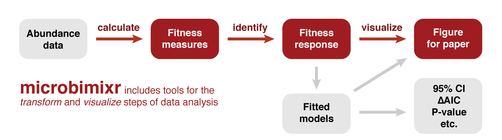
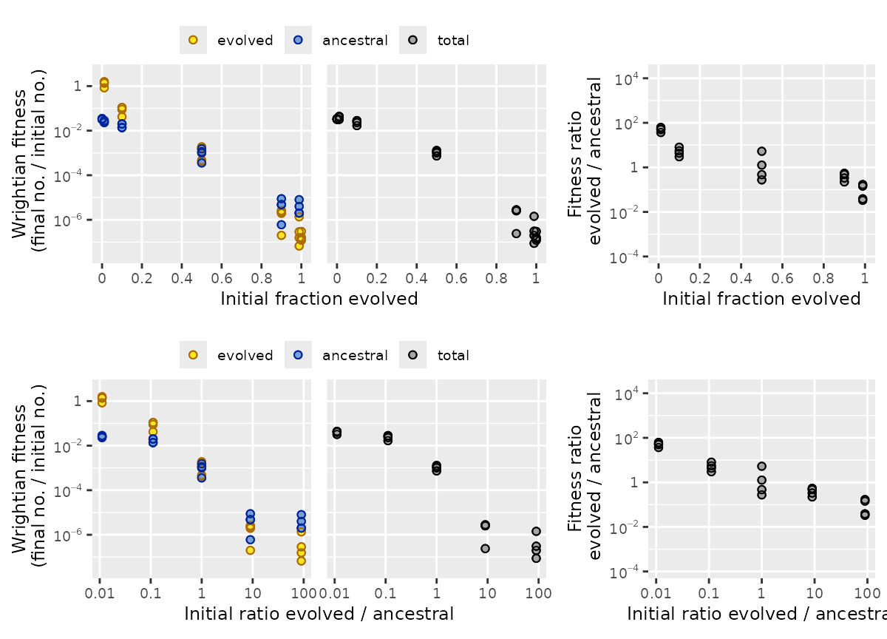
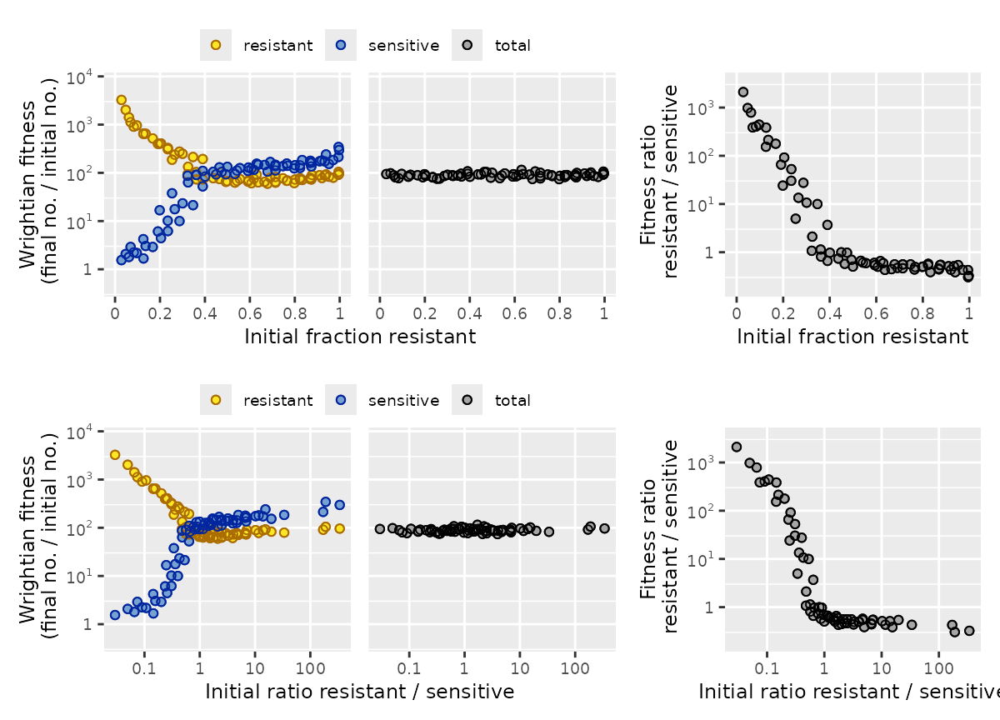
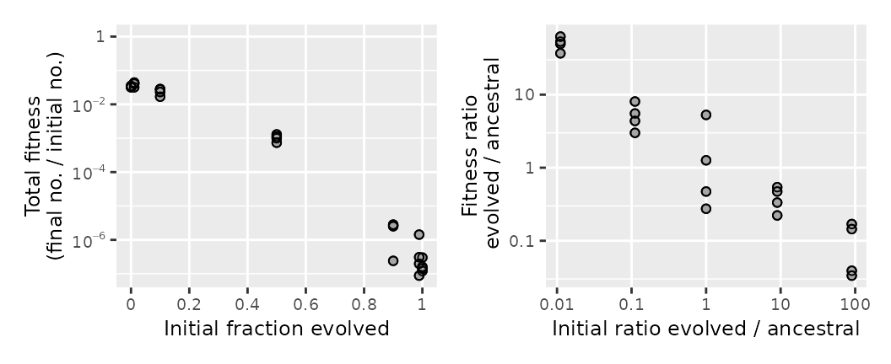
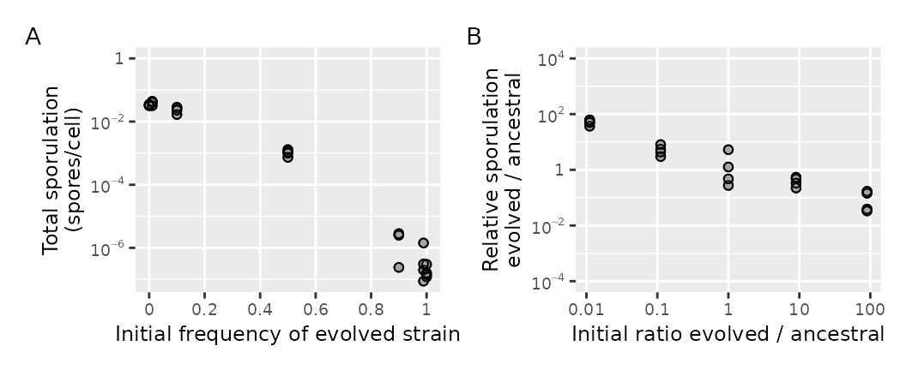
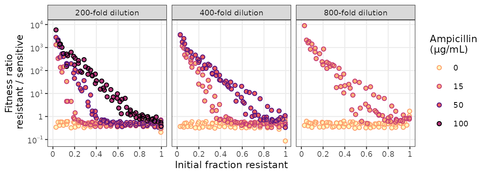

# Analyzing microbial interactions with microbimixr

A common way to study cooperation and conflict among microbes is to do
mix experiments: you mix together two different strains then measure how
their behavior depends on mix frequency. How do they act differently
together than they do on their own? How does mixing affect their
survival and reproduction—their fitness?

microbimixr helps you analyze mix experiments by making it easy to:

- Calculate best-practice fitness measures
- Identify which fitness measures are best for your data and research
  question
- Visualize interaction effects as publication-quality figures



The basic workflow is:

1.  Start with a data frame of observed microbial abundances
2.  Calculate fitness measures with
    [`calculate_mix_fitness()`](https://matryoshkev.github.io/microbimixr/reference/calculate_mix_fitness.md)
3.  Identify which fitness and frequency measures to use with
    [`plot_mix_fitness()`](https://matryoshkev.github.io/microbimixr/reference/plot_mix_fitness.md)
4.  Plot fitness data using microbimixr’s visualization tools
5.  Fit statistical models and plot them with your data

## Starting data

The starting point for microbimixr is a data frame that has the observed
abundance of each microbe at the beginning of the experiments and at the
end. The data could be any combination of strain abundance (like cell
counts or cell densities), strain frequency (the fraction of the total),
or total abundance (all strains added together)—anything that’s enough
to define the absolute abundance of each strain. Each row of the data
frame should have all the data for a single observational unit: one
experimental replicate with one strain combination, one mix frequency,
one combination of experimental treatments, and so on.

Here’s an example with a dataset that’s included in the package. This is
from a small experiment mixing a wild-type strain of *Myxococcus*
bacteria with an experimentally-evolved cheater strain and letting them
make multicellular fruiting bodies together (smith *et al.* 2010). The
abundance quantities here are the number of cells from each strain
before and after development.

``` r

library(microbimixr)
head(data_smith_2010)
#>   exptl_block initial_cells_evolved initial_cells_ancestral
#> 1  2009-04-29               5.0e+08                 0.0e+00
#> 2  2009-04-29               4.5e+08                 5.0e+06
#> 3  2009-04-29               4.5e+08                 5.0e+07
#> 4  2009-04-29               2.5e+08                 2.5e+08
#> 5  2009-04-29               5.0e+07                 4.5e+08
#> 6  2009-04-29               5.0e+06                 4.5e+08
#>   final_spores_evolved final_spores_ancestral
#> 1                   60                      0
#> 2                   70                     20
#> 3                 1170                    240
#> 4               107000                 390000
#> 5              2100000                6300000
#> 6              4210000               10300000
```

Here’s another example. This is from an experiment that grew an
antibiotic-sensitive strain of *E. coli* together with an
antibiotic-resistant strain that detoxifies its local environment
(Yurtsev *et al.* 2013). The abundance quantities are total cell density
(in units of OD₆₀₀) and the fraction of cells that are the resistant
strain (from flow cytometry). The data include several experimental
treatments with different concentrations of antibiotic (`ampicillin`)
and different amounts of culture growth (`dilution`).

``` r

head(data_Yurtsev_2013)
#>   ampicillin dilution replicate culture_id OD_initial
#> 1          0      100         0          0 0.01438755
#> 2          0      100         0          1 0.01424020
#> 3          0      100         0          2 0.01662601
#> 4          0      100         0          3 0.01394884
#> 5          0      100         0          4 0.01574443
#> 6          0      100         0          5 0.01588097
#>   fraction_resistant_initial OD_final fraction_resistant_final
#> 1              -0.0003784523 1.664976            -0.0001694705
#> 2               0.0473674563 1.453604             0.0256142444
#> 3               0.0831943961 1.662601             0.0559489629
#> 4               0.1360970434 1.735172             0.0795238821
#> 5               0.1909207725 1.769998             0.1141049001
#> 6               0.2346178261 1.479329             0.1382856545
```

microbimixr works with most types of microbial abundance data including
cell counts, cell density, optical density, and strain frequency.

## Calculate fitness measures

There are lots of quantities you can calculate to measure microbial
survival and reproduction. Many of them work well enough for a
particular system and particular research question. But only a few are
robust enough to be quantitatively meaningful across different species
and different types of interaction (smith & Inglis 2021). microbimixr
makes it easy to calculate the good ones.

The function to calculate fitness is
[`calculate_mix_fitness()`](https://matryoshkev.github.io/microbimixr/reference/calculate_mix_fitness.md).
It takes an input data frame of microbial abundances and a character
vector describing what the columns in the data are. Then it returns a
data frame with several measures of fitness and two measures of mix
frequency. Here’s an example:

``` r

fitness_myxo <- calculate_mix_fitness(
    data = data_smith_2010, 
    var_names = c(
        initial_number_A = "initial_cells_evolved",
        initial_number_B = "initial_cells_ancestral",
        final_number_A = "final_spores_evolved",
        final_number_B = "final_spores_ancestral", 
        name_A = "evolved", 
        name_B = "ancestral"
    )
)
head(fitness_myxo)
#>    name_A    name_B initial_fraction_A initial_ratio_A_B    fitness_A
#> 1 evolved ancestral         1.00000000               Inf 1.200000e-07
#> 2 evolved ancestral         0.98901099       90.00000000 1.555556e-07
#> 3 evolved ancestral         0.90000000        9.00000000 2.600000e-06
#> 4 evolved ancestral         0.50000000        1.00000000 4.280000e-04
#> 5 evolved ancestral         0.10000000        0.11111111 4.200000e-02
#> 6 evolved ancestral         0.01098901        0.01111111 8.420000e-01
#>    fitness_B fitness_total fitness_ratio_A_B
#> 1         NA  1.200000e-07                NA
#> 2 0.00000400  1.978022e-07        0.03888889
#> 3 0.00000480  2.820000e-06        0.54166667
#> 4 0.00156000  9.940000e-04        0.27435897
#> 5 0.01400000  1.680000e-02        3.00000000
#> 6 0.02288889  3.189011e-02       36.78640777
```

The `var_names` argument tells the function what kinds of data you have
and which strain is which. In the output, `initial_fraction_A` and
`initial_ratio_A_B` are two measures of strain frequency. `fitness_A`
and `fitness_B` are the absolute fitness of each strain. `fitness_total`
is the fitness of the total group or subpopulation. And
`fitness_ratio_A_B` is the ratio of strain A fitness to strain B
fitness.

Here’s an example with the *E. coli* data:

``` r

fitness_ecoli <- calculate_mix_fitness(
    data = data_Yurtsev_2013,
    var_names = c(
        initial_number_total = "OD_initial",
        initial_fraction_A = "fraction_resistant_initial",
        final_number_total = "OD_final",
        final_fraction_A = "fraction_resistant_final",
        name_A = "AmpR",
        name_B = "AmpS"
    )
)
#> Warning in calculate_mix_fitness(): Some fraction_resistant_initial values not
#> in range [0, 1] -- not biologically meaningful
#> Warning in calculate_mix_fitness(): Some fraction_resistant_final values not in
#> range [0, 1] -- not biologically meaningful
```

Notice the warnings.
[`calculate_mix_fitness()`](https://matryoshkev.github.io/microbimixr/reference/calculate_mix_fitness.md)
will warn you if any of the data aren’t biologically meaningful. There
can’t be a negative number of cells, for example, and fractions are
bounded at zero and one. Some of the *E. coli* data include negative
fractions—probably an artifact of correcting for background fluorescence
in flow cytometry. Let’s drop those points.

``` r

fitness_ecoli <- 
    data_Yurtsev_2013 |>
    subset(
        fraction_resistant_initial > 0 & fraction_resistant_initial < 1 &
        fraction_resistant_final > 0 & fraction_resistant_final < 1
    ) |>
    calculate_mix_fitness(
        var_names = c(
            initial_number_total = "OD_initial",
            initial_fraction_A = "fraction_resistant_initial",
            final_number_total = "OD_final",
            final_fraction_A = "fraction_resistant_final",
            name_A = "AmpR",
            name_B = "AmpS"
        ), 
        keep = c("ampicillin", "dilution")
    )
```

The `keep` argument lets you include columns from the input data in the
fitness output for experimental treatments, experimental block, and so
on:

``` r

head(fitness_ecoli)
#>   ampicillin dilution name_A name_B initial_fraction_A initial_ratio_A_B
#> 2          0      100   AmpR   AmpS         0.04736746        0.04972269
#> 3          0      100   AmpR   AmpS         0.08319440        0.09074377
#> 4          0      100   AmpR   AmpS         0.13609704        0.15753742
#> 5          0      100   AmpR   AmpS         0.19092077        0.23597290
#> 6          0      100   AmpR   AmpS         0.23461783        0.30653683
#> 7          0      100   AmpR   AmpS         0.26563355        0.36171798
#>   fitness_A fitness_B fitness_total fitness_ratio_A_B
#> 2  55.19903  104.4084     102.07749         0.5286838
#> 3  67.25088  102.9718     100.00000         0.6531001
#> 4  72.68639  132.5415     124.39537         0.5484049
#> 5  67.18882  123.0941     112.42060         0.5458331
#> 6  54.90398  104.8752      93.15104         0.5235174
#> 7  57.74006  101.0767      89.56501         0.5712502
```

### Fitness math

The actual fitness calculations are very simple. If the initial
abundance of each strain (measured as the number or density of cells or
virions) is \\n_A\\ and \\n_B\\, and their final abundances are
\\n'\_A\\ and \\n'\_B\\, then

\\\begin{aligned} \texttt{fitness_A} &= \\ n'\_A / n_A = w_A \\
\texttt{fitness_B} &= \\ n'\_B / n_B = w_B \\ \texttt{fitness_total} &=
\\ (n'\_A + n'\_B) / (n_A + n_B) \\ \texttt{fitness_ratio_A_B} &= \\ w_A
/ w_B \end{aligned}\\

These quantities are absolute Wrightian fitness measured over the entire
time period between the initial and final abundances. They measure fold
change in abundance. So if a bacterial strain’s cell density increases
100-fold, for example, its fitness will be \\w = 100\\. If it decreases
to 10% of its initial density, its fitness will be \\w = 0.1\\. They’re
usually best visualized and analyzed over \\\log\_{10}\\ scales.

These fitness measures are robust across different species and types of
interaction (smith & Inglis 2021). They let you quantitatively compare
fitness effects across systems. They’re good for statistical analyses of
effect sizes and confidence intervals. And they’re directly comparable
to fitness terms in theoretical models of microbial evolution. Kin
selection and game theory approaches would use strain fitness.
Multilevel selection would use total fitness and the fitness ratio.

The two measures of mix frequency are:

\\\begin{aligned} \texttt{initial_fraction_A} &= \\ n_A / (n_A + n_B) \\
\texttt{initial_ratio_A_B} &= \\ n_A / n_B \end{aligned}\\

`initial_fraction_A` runs from 0 to 1. `initial_ratio_A_B` runs from
negative infinity to positive infinity and is best analyzed over
\\\log\_{10}\\ scales.

## Identify which fitness measures to use

Microbial interactions are often easier to visualize, analyze, and
interpret with some fitness outcomes more than others, but it’s not
always clear ahead of time which they’ll be (smith & Inglis 2021). To
see which measures would be best for your data and research question,
use
[`plot_mix_fitness()`](https://matryoshkev.github.io/microbimixr/reference/plot_mix_fitness.md).
It draws a combined plot that lets you compare strain fitness, total
fitness, and the ratio of strain fitnesses. It also lets you compare
linear and logarithmic measures of strain frequency.

``` r

plot_mix_fitness(fitness_myxo)
```



The *Myxo* results would be easiest to interpret and analyze as total
fitness as a function of initial genotype fraction and fitness ratio as
a function of initial genotype ratio. They’re the simplest fitness
responses and easiest to fit statistical models to.

For complex datasets with many strain combinations or treatment
conditions, it may be easier to inspect subsets of the data.

``` r

fitness_ecoli |>
subset(ampicillin == 100 & dilution == 100) |>
plot_mix_fitness()
```



For the *E. coli* results, total fitness is just a constant determined
by experimental conditions—how much the culture was diluted when
passaged. So fitness ratio by itself is a succinct measure of the
interesting effects. The fitness response looks simpler on the linear
frequency scale.

## Plot fitness data

Once you know which fitness measures to focus on, you can use
microbimixr to make figures for the paper. The simplest way is to use
its built-in functions:
[`plot_strain_fitness()`](https://matryoshkev.github.io/microbimixr/reference/plot_strain_fitness.md),
[`plot_total_fitness()`](https://matryoshkev.github.io/microbimixr/reference/plot_total_fitness.md),
and
[`plot_fitness_ratio()`](https://matryoshkev.github.io/microbimixr/reference/plot_fitness_ratio.md).
They’re a straight-forward way to make figures designed for fitness
data.

``` r

library(patchwork)
plot_total_fitness(fitness_myxo) + 
plot_fitness_ratio(fitness_myxo, mix_scale = "ratio")
```



The plot functions have some basic options:

``` r

plot_total_fitness(
    fitness_myxo,
    xlab = "Initial frequency of evolved strain",
    ylab = "Total sporulation\n(spores/cell)"
) +
plot_fitness_ratio(
    fitness_myxo, 
    mix_scale = "ratio",
    xlab = "Initial ratio evolved / ancestral",
    ylab = "Relative sporulation\nevolved / ancestral",
    ylim = c(1e-4, 1e4)
)
```



You can customize microbimixr plots even more with the
[ggplot2](https://ggplot2.tidyverse.org/) package. This is great for
showing different experimental conditions.

``` r

library(ggplot2)
fitness_ecoli |>
    subset(ampicillin %in% c(0, 15, 50, 100) & dilution %in% c(200, 400, 800)) |>
    plot_fitness_ratio() +
    aes(color = factor(ampicillin), fill = factor(ampicillin)) +
    scale_color_viridis_d(
        name = "Ampicillin\n(µg/mL)", option = "magma", 
        direction = -1, begin = 0, end = 0.8
    ) +
    scale_fill_viridis_d(
        name = "Ampicillin\n(µg/mL)", option = "magma",
        direction = -1, begin = 0.5, end = 1
    ) +
    facet_wrap(~ dilution, labeller = as_labeller(function(x) paste0(x, "-fold dilution"))) +
    theme_bw(base_size = 9)
```



## References

- smith j, Van Dyken JD, and Zee PC (2010) A generalization of
  Hamilton’s rule for the evolution of microbial cooperation. *Science*
  **328:** 1700-1703. <https://doi.org/10.1126/science.1189675>

- smith j and Inglis RF (2021) Evaluating kin and group selection as
  tools for quantitative analysis of microbial data. *Proceedings B*
  **288:** 20201657. <https://doi.org/10.1098/rspb.2020.1657>

- Yurtsev EA, Chao HX, Datta MS, Artemova T, and Gore J (2013) Bacterial
  cheating drives the population dynamics of cooperative antibiotic
  resistance plasmids. *Molecular Systems Biology* **9:** 683.
  <https://doi.org/10.1038/msb.2013.39>
