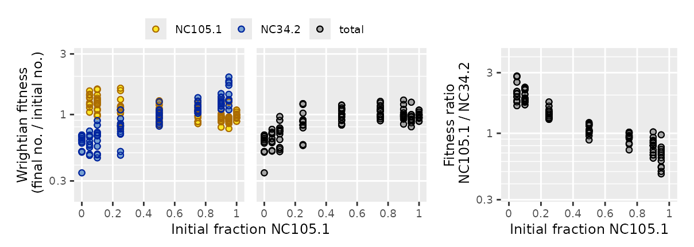
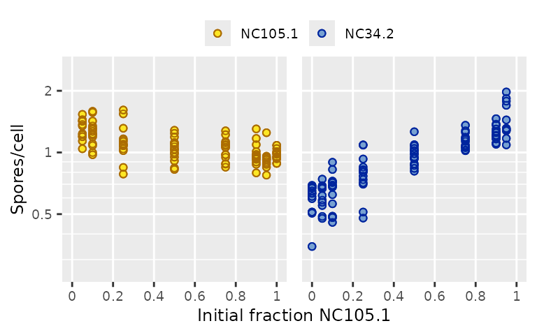
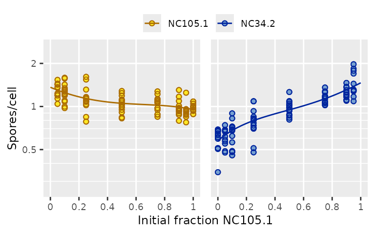

# Working with strain fitness

It can be very useful to analyze how microbial interactions affect the
absolute fitness of each strain. Strains may react differently to
mixing, for example (smith & Inglis 2021). But plotting strain fitness
and fitting models to it can be a little tricky.

## Plotting strain fitness

Total fitness and the relative ratio of strain fitnesses are
fundamentally different quantities from each other, so they need their
own plots and their own fitted models. But the fitness of one strain is
the same kind of quantity as the fitness of another strain. They can be
plotted on the same axis.

Let’s look at a dataset included in microbimixr where different natural
isolates of *Dictyostelium* amoebae were starved, mixed, and allowed to
form fruiting bodies together (Madgwick et al. 2018).

``` r

library(microbimixr)
fitness_dicty <-
    data_Madgwick_2018 |>
    calculate_mix_fitness(var_names = c(
        initial_number_total = "input_cells_total",
        initial_fraction_A = "input_freq_i",
        final_number_total = "spores_total",
        final_fraction_A = "output_freq_i",
        name_A = "strain_i",
        name_B = "strain_j"
    ))
```

Here fitness is measuring cells that survived as spores instead of dying
and becoming part of the fruiting body’s stalk. There are a bunch of
different strain pairs in the dataset. Let’s focus on one of them:

``` r

fitness_pair <- subset(fitness_dicty, name_A == "NC105.1" & name_B == "NC34.2") 
plot_mix_fitness(fitness_pair, mix_scale = "fraction")
```



The strain-fitness plot shows that both strains make more spores when
they’re rare (because they contribute fewer cells to the stalk). That
result isn’t visible in the plots of total fitness or fitness ratio. The
fitness ratio plot shows that sporulation is negatively
frequency-dependent, but it doesn’t show how much each strain
contributes to that.

Strain fitness plots are often crowded, so it can be useful to use the
`facet_strains` argument:

``` r

fig_strain_fitness <- 
    plot_strain_fitness(fitness_pair, ylab = "Spores/cell", facet_strains = TRUE)
fig_strain_fitness
```



Behind the scenes,
[`plot_strain_fitness()`](https://matryoshkev.github.io/microbimixr/reference/plot_strain_fitness.md)
converts fitness data from wide format (where each row has data for both
strains) to long format (where each strain has its own row). With
long-format data we can plot both strains on the same `fitness` axis and
`strain` can be mapped to point color or used as a facetting variable.

## Models of strain fitness

When you make figures to show your data in papers and talks, it’s a good
idea to also plot the models you use to analyze the data. This helps
your audience understand how the models explain the data. It also helps
you make sure the model is doing what you want it to!

### Wide-format models

One approach is to use models that predict wide-format fitness. This
could be a set of differential equations describing what happens to each
strain between the initial and final states of the mix experiment
(Yurtsev et al. 2013). Or it could just be descriptive statistical
models fit separately to each strain:

``` r

model_A <- lm(fitness_A ~ poly(initial_fraction_A, 3), data = fitness_pair)
model_B <- update(model_A, fitness_B ~ poly(initial_fraction_A, 3))
```

To show the predicted fitness values as smooth curves, make a new data
frame for them with a range of intermediate mixing frequencies. Here
we’ll do that using [dplyr](https://dplyr.tidyverse.org), which can make
data-wrangling easier to read:

``` r

library(dplyr)
fitted_wide <- data.frame(initial_fraction_A = seq(0, 1, by = 0.02))
fitted_wide <- fitted_wide |>
    mutate(
        fitness_A = predict(model_A, newdata = fitted_wide),
        fitness_B = predict(model_B, newdata = fitted_wide),
        name_A = "NC105.1",
        name_B = "NC34.2"
    )
```

To plot the fitted model we need to need to convert its predicted values
to long format. You could do that yourself using
[`reshape()`](https://rdrr.io/r/stats/reshape.html) in base R or
`tidyr::pivot_longer()`, but microbimixr includes
[`lengthen_strain_fitness()`](https://matryoshkev.github.io/microbimixr/reference/lengthen_strain_fitness.md)
to make it easy. Then add it to the figure as a line using
[ggplot2](https://ggplot2.tidyverse.org/):

``` r

library(ggplot2)
fig_strain_fitness +
    geom_line(data = lengthen_strain_fitness(fitted_wide), na.rm = TRUE)
```


### Long-format models

Another approach is to fit a single model where fitness is a function of
two variables: strain and mixing frequency. This is analogous to the
“neighbor-modulated fitness” formulation of kin selection (Taylor &
Frank 1996). For these you fit the model to long-format data:

``` r

model_long <- lm(
    fitness ~ strain * poly(initial_fraction_A, 3),
    data = lengthen_strain_fitness(fitness_pair)
)
```

Then make a long-format data frame for the fitted model’s predicted
values:

``` r

fitted_long <- expand.grid(
    initial_fraction_A = seq(0, 1, by = 0.02),
    strain = c("NC105.1", "NC34.2")
)
fitted_long$fitness <- predict(model_long, newdata = fitted_long)
```

And add it to the plotted figure:

``` r

fig_strain_fitness + geom_line(data = fitted_long, na.rm = TRUE)
```



## References

- Madgwick PG, Stewart B, Belcher LJ, Thompson CRL, and Wolf JB (2018)
  Strategic investment explains patterns of cooperation and cheating in
  a microbe. *PNAS* **115:** E4823-E4832.
  <https://doi.org/10.1073/pnas.1716087115>

- smith j and Inglis RF (2021) Evaluating kin and group selection as
  tools for quantitative analysis of microbial data. *Proceedings B*
  **288:** 20201657. <https://doi.org/10.1098/rspb.2020.1657>

- Taylor PD and Frank SA (1996) How to make a kin selection model.
  *Journal of Theoretical Biology* **180:** 27-37.
  <https://10.1006/jtbi.1996.0075>

- Yurtsev EA, Chao HX, Datta MS, Artemova T, and Gore J (2013) Bacterial
  cheating drives the population dynamics of cooperative antibiotic
  resistance plasmids. *Molecular Systems Biology* **9:** 683.
  <https://10.1038/msb.2013.39>
