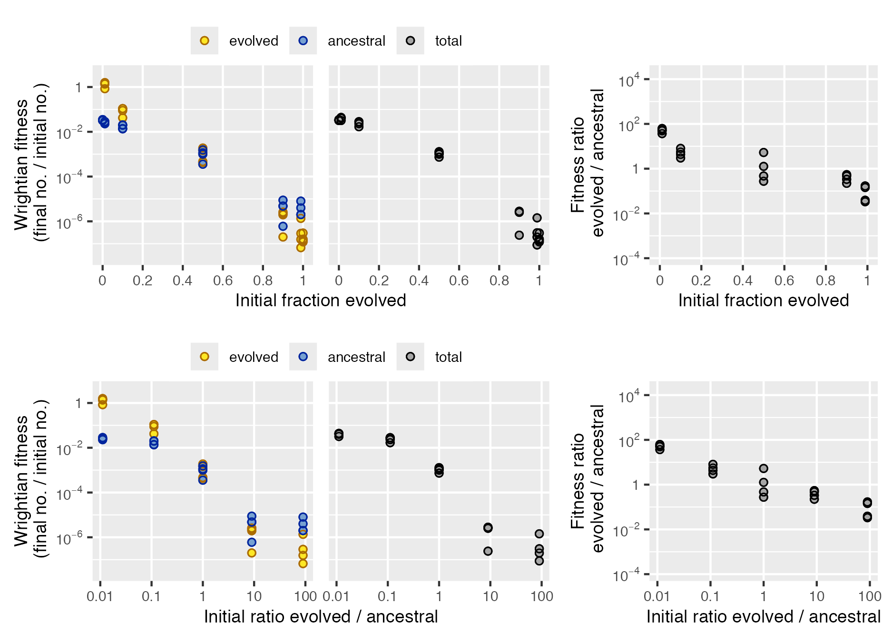

# microbimixr

## Analyze microbial interactions in mix experiments

Studies of cooperation and conflict among microbes often use a common
experimental design: mix together two microbes (different strains of
bacteria, for example) then measure how their survival and reproduction
depend on strain frequency. How do they act differently together than
they do on their own? microbimixr helps you get the most out of this
data by providing tools to:

- Calculate best-practice fitness measures
- Identify which fitness measures are best for your data and research
  question
- Visualize interaction effects as publication-quality figures


## Calculate fitness measures

There are many ways to quantify microbial survival and reproduction.
microbimixr makes it easy to calculate fitness measures that are:

- Robust and quantitatively comparable across different species and
  different types of interaction
- Well-suited to statistical analysis of effect sizes and confidence
  intervals
- Useful for both individual and group-centered approaches to social
  behavior
- Directly comparable to theoretical models of microbial evolution

Starting from a data frame with the initial and final abundance of each
microbe, calculate fitness with
[`calculate_mix_fitness()`](https://matryoshkev.github.io/microbimixr/reference/calculate_mix_fitness.md):

``` r

library("microbimixr")
fitness_myxo <- calculate_mix_fitness(
    data_smith_2010, 
    var_names = c(
        initial_number_A = "initial_cells_evolved",
        initial_number_B = "initial_cells_ancestral",
        final_number_A = "final_spores_evolved",
        final_number_B = "final_spores_ancestral", 
        name_A = "evolved", 
        name_B = "ancestral"
    )
)
head(fitness_myxo)
#>    name_A    name_B initial_fraction_A initial_ratio_A_B    fitness_A
#> 1 evolved ancestral         1.00000000               Inf 1.200000e-07
#> 2 evolved ancestral         0.98901099       90.00000000 1.555556e-07
#> 3 evolved ancestral         0.90000000        9.00000000 2.600000e-06
#> 4 evolved ancestral         0.50000000        1.00000000 4.280000e-04
#> 5 evolved ancestral         0.10000000        0.11111111 4.200000e-02
#> 6 evolved ancestral         0.01098901        0.01111111 8.420000e-01
#>    fitness_B fitness_total fitness_ratio_A_B
#> 1         NA  1.200000e-07                NA
#> 2 0.00000400  1.978022e-07        0.03888889
#> 3 0.00000480  2.820000e-06        0.54166667
#> 4 0.00156000  9.940000e-04        0.27435897
#> 5 0.01400000  1.680000e-02        3.00000000
#> 6 0.02288889  3.189011e-02       36.78640777
```

microbimixr works with most types of microbial abundance data including
cell counts, cell density, optical density, and strain frequency.

## Identify fitness response

To quickly see what fitness measures would be most useful for your
research question and data, use
[`plot_mix_fitness()`](https://matryoshkev.github.io/microbimixr/reference/plot_mix_fitness.md).
It draws a combined figure that lets you compare strain fitness, total
fitness, and the ratio of strain fitnesses. It also lets you compare
linear and logarithmic measures of strain frequency.

``` r

plot_mix_fitness(fitness_myxo)
```



For example, this interaction between two genotypes of *Myxococcus*
bacteria would be easiest to interpret and analyze as total fitness as a
function of initial genotype fraction and fitness ratio as a function of
initial genotype ratio. They’re the simplest fitness responses and
easiest to fit statistical models to. These plots also let you interpret
your data in terms of the different fitness outcomes used by theories of
social evolution like kin selection, multilevel selection, and game
theory.

## Visualize fitness effects

Once you know which fitness measures to analyze, you can use microbimixr
to make publication-quality figures. The package includes convenience
functions to plot data with default settings appropriate for mix
experiments. Fitness axes are plotted on \\\log\_{10}\\ scales, for
example, include 1 for reference (no net change in abundance), and have
a minimum ten-fold range.

``` r

library("patchwork")
fig_total <- plot_total_fitness(fitness_myxo)
fig_ratio <- plot_fitness_ratio(fitness_myxo, mix_scale = "ratio", ylim = c(1e-4, 1e4))
fig_total + fig_ratio
```


You can also customize these plots using the
[ggplot2](https://ggplot2.tidyverse.org/) graphics package:

``` r

library("ggplot2")
fitness_myxo |>
    plot_total_fitness(
        xlab = "Initial frequency of evolved strain",
        ylab = "Total sporulation\n(spores/cell)", 
        ylim = c(1e-8, 1), color = "darkblue", fill = "skyblue"
    ) +
    geom_smooth(
        method = "lm", formula = y ~ poly(x, 2), 
        se = FALSE, linewidth = 0.5
    ) +
    theme_bw(base_size = 9)
```


## Install microbimixr

``` r

# Install the development version from GitHub:
# install.packages("devtools")
devtools::install_github("matryoshkev/microbimixr", build_vignettes = TRUE)
```

## Further reading

- smith j and Inglis RF (2021) Evaluating kin and group selection as
  tools for quantitative analysis of microbial data. Proceedings B
  288:20201657. <https://doi.org/10.1098/rspb.2020.1657>
