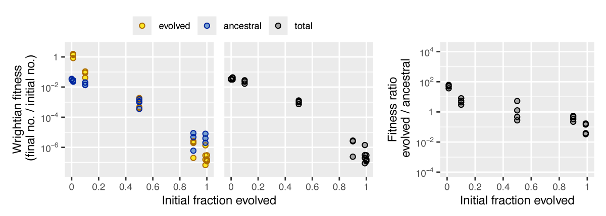

# microbimixr

microbimixr is an R package to analyze the fitness effects of microbial
interactions. Studies of conflict and cooperation among microbes often
use a common experimental design: mix together two strains then measure
how their survival and reproduction depend on strain frequency. How do
they act differently together than they do on their own?

microbimixr helps you get the most out of this data by providing tools
to:

- Calculate best-practice fitness measures
- Identify which fitness measures are best for your data and research
  question
- Visualize interaction effects as publication-quality figures


There are many ways to quantify microbial survival and reproduction.
microbimixr makes it easy to use fitness measures that are:

- Robust and quantitatively comparable across different species and
  different types of interaction
- Well-suited to statistical analysis of effect sizes and confidence
  intervals
- Useful for both individual and group-centered approaches to social
  behavior
- Directly comparable to theoretical models based on kin selection,
  multilevel selection, or game theory

microbimixr works with most types of microbial abundance data including
cell counts, cell density, optical density, and strain frequency.

## Example usage

``` r

library(microbimixr)

# Calculate fitness measures
fitness_myxo <- 
    data_smith_2010 |>
    calculate_mix_fitness(
        var_names = c(
            initial_number_A = "initial_cells_evolved",
            initial_number_B = "initial_cells_ancestral",
            final_number_A = "final_spores_evolved",
            final_number_B = "final_spores_ancestral", 
            name_A = "evolved", 
            name_B = "ancestral"
        ),
        keep = "exptl_block"
    )
head(fitness_myxo)
#>   exptl_block  name_A    name_B initial_fraction_A initial_ratio_A_B
#> 1  2009-04-29 evolved ancestral         1.00000000               Inf
#> 2  2009-04-29 evolved ancestral         0.98901099       90.00000000
#> 3  2009-04-29 evolved ancestral         0.90000000        9.00000000
#> 4  2009-04-29 evolved ancestral         0.50000000        1.00000000
#> 5  2009-04-29 evolved ancestral         0.10000000        0.11111111
#> 6  2009-04-29 evolved ancestral         0.01098901        0.01111111
#>      fitness_A  fitness_B fitness_total fitness_ratio_A_B
#> 1 1.200000e-07         NA  1.200000e-07                NA
#> 2 1.555556e-07 0.00000400  1.978022e-07        0.03888889
#> 3 2.600000e-06 0.00000480  2.820000e-06        0.54166667
#> 4 4.280000e-04 0.00156000  9.940000e-04        0.27435897
#> 5 4.200000e-02 0.01400000  1.680000e-02        3.00000000
#> 6 8.420000e-01 0.02288889  3.189011e-02       36.78640777
```

``` r

# Compare fitness measures
plot_mix_fitness(fitness_myxo, mix_scale = "fraction")
```



## Install microbimixr

``` r

# Install the development version from GitHub:
# install.packages("devtools")
devtools::install_github("matryoshkev/microbimixr", build_vignettes = TRUE)
```

## Further reading

- smith j and Inglis RF (2021) Evaluating kin and group selection as
  tools for quantitative analysis of microbial data. Proceedings B
  288:20201657. <https://doi.org/10.1098/rspb.2020.1657>
